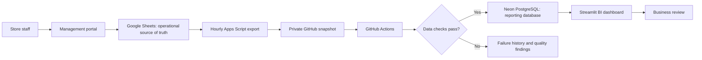

# Intelligent Superstore Management & Automated BI Reporting

An automated retail operations and business intelligence platform that connects day-to-day supermarket activity with centralized reporting. Staff manage transactions through a web portal; scheduled cloud workflows validate and synchronize those records to PostgreSQL, where an interactive dashboard makes sales, profitability, customer, and inventory performance available for review.

The workflow removes the need to download spreadsheets, transfer files, or manually prepare each reporting refresh.

## Applications

| Application | Purpose | Access |
| --- | --- | --- |
| Superstore Management Portal | Manage products, customers, purchasing, stock, sales, returns, and shipping | [Open management portal](https://script.google.com/macros/s/AKfycbyROAhBtZxk_GmJT6BkfOGGB2gb7HLJOW5crxuyTCPfCzKoeoabcm2Qd1IRnEqQehTK/exec) |
| Business Intelligence Dashboard | Review operational performance, reporting freshness, and pipeline history | [Open BI dashboard](https://automated-bi-reporting-pipeline.streamlit.app/) |

Portal access depends on the Google account and deployment permissions configured by the administrator. Dashboard access follows its hosting configuration.

## Business purpose

Supermarket activity spans purchasing, receiving, selling, restocking, and customer service. This project brings those activities into a connected workflow so that business reporting follows the operational records consistently.

- Maintain a shared product catalogue, customer base, and supplier directory.
- Record stock changes alongside purchases, sales, transfers, and accepted returns.
- Preserve the prices and costs associated with historical sales.
- Deliver repeatable reporting without depending on an operator's computer.
- Make failed refreshes and data-quality problems visible before they affect published reports.

## Automation workflow

### 1. Capture operational activity

Authorized staff use the management portal to create or maintain business records. Transactions update related records together: for example, a completed sale records its items and stock movements, while a goods receipt increases stock only for accepted quantities. Payments are recorded separately from the sale.

Google Sheets holds the operational records. Business references such as **CUS-0001**, **PRD-0001**, and **SO-000001** make records easier to identify, while stable internal identifiers preserve their relationships.

### 2. Export a consistent snapshot

An hourly Apps Script trigger checks the operational workbook and prepares a compressed snapshot for a **private GitHub repository**. The export includes related operational tables so that customers, products, orders, receipts, returns, and stock can be validated together.

Changed data produces a new snapshot commit. Unchanged data is normally skipped; a heartbeat export after approximately 12 hours keeps the snapshot timestamp fresh even when there are no business changes.

### 3. Start the reporting pipeline

A snapshot commit automatically triggers **GitHub Actions**. A separate hourly schedule rechecks the latest snapshot, allowing another attempt when an earlier refresh failed or could not acquire the database writer lock. Each workflow allows up to three bounded attempts; authorized operators can also start it manually.

### 4. Validate before loading

The pipeline checks required fields, data types, unique references, relationships, transaction quantities, payment and refund limits, and stock-ledger reconciliation. It also rejects snapshots that are more than 26 hours old or more than five minutes in the future.

A failed check prevents the reporting-data update. The system retains the last successfully loaded business data and records the failed execution and applicable quality findings for investigation.

### 5. Synchronize the reporting database

Valid records are synchronized to **Neon PostgreSQL**. New records are inserted, and existing records are updated only when the source version is newer. Reprocessing the same snapshot does not duplicate transactions, and an older snapshot cannot overwrite a newer record.

A shared writer lock prevents overlapping loads. Reporting-data changes, load progress, and successful execution status commit together.

### 6. Review business performance

The **Streamlit dashboard** reads the reporting database. Users can filter supported sales reports by period, store, and category, inspect charts and tables, and download report results as CSV.

The dashboard caches data for up to 60 seconds. Its **Refresh data** control clears the cache and reloads the dashboard data. Dashboard refresh does not trigger an export or ETL job; it reads the latest successful database load.

## Retail operating workflow

| Business activity | Operational outcome |
| --- | --- |
| Maintain masters | Keep products, categories, brands, customers, suppliers, stores, and segments organized |
| Create a purchase order | Record ordered products, quantities, supplier, and expected delivery |
| Receive goods | Track received and accepted quantities; post accepted stock to the selected store |
| Manage inventory | Review availability, record reasoned adjustments, and transfer stock between stores |
| Complete a sale | Preserve line prices and costs, apply discounts and tax, and reduce available stock |
| Record a payment | Track staff-confirmed settlement independently from the sale |
| Accept a return | Reference the original sale, limit returned quantities, and restock eligible goods |
| Record a refund | Limit settlement to accepted returned value and payments already received |
| Track shipping | Record dispatch and delivery status against an order |
| Review audit history | Trace changes to their actor, business record, and recorded time |

## Reporting coverage

| Dashboard area | Business questions |
| --- | --- |
| Executive overview | What are net sales, gross profit, completed orders, average order value, and gross margin? |
| Sales performance | How do sales vary across months, stores, regions, and categories? |
| Product profitability | Which products contribute the most profit, and how does product margin compare? |
| Customer intelligence | Which customers purchase repeatedly, and how do customer segments contribute to sales? |
| Inventory intelligence | What stock is available, which items need reordering, and what is the current stock value? |
| Operational monitoring | When did reporting last refresh, which loads succeeded or failed, and what quality findings were recorded? |

### Reporting interpretation

- **Net sales exclude tax.** Accepted returns reduce revenue and reverse the original cost of the returned units.
- **Returns restate the original sale date.** Historical sales periods can therefore change after a return is accepted.
- **Payments and refunds describe settlement.** They are separate from revenue recognition.
- **Inventory is a current snapshot.** Sales-period filters do not turn it into historical stock reporting.
- **Stock value uses current product cost.** FIFO valuation, lot ageing, and inventory turnover are outside the implemented scope.

See the [business rules](docs/business_rules.md) for the complete reporting definitions.

## Schedule and expected freshness

| Event | Timing or behavior |
| --- | --- |
| Portal transaction | Saved to the operational workbook when the transaction succeeds |
| Operational export | Checked hourly by Apps Script |
| Snapshot-triggered ETL | Queued after a changed or heartbeat snapshot is committed |
| Scheduled ETL recheck | Hourly, at minute 17 UTC, subject to GitHub runner availability |
| Unchanged-source heartbeat | Exported after approximately 12 hours without a new snapshot |
| Dashboard data cache | Up to 60 seconds; users can clear it with **Refresh data** |

This is scheduled synchronization. Apps Script triggers and GitHub runners are best-effort services, so changes are not guaranteed to appear at an exact minute. The configured cloud workflow continues when the operator's computer is off and requires no local Docker service or manual Excel export.

## Monitoring and recovery

Use three checkpoints when investigating a missing update:

1. **Apps Script ? Executions:** confirm that the export completed and inspect trigger or authorization failures.
2. **GitHub ? Actions ? Automatic retail snapshot to Neon:** confirm that the latest snapshot was processed successfully. Review the failed step when a run fails.
3. **Dashboard ? Operational monitoring:** check the latest successful refresh, execution history, and recorded quality findings before interpreting report totals.

Correct invalid operational records through the authorized workflow, then allow the next export and scheduled load to run. An administrator can export immediately and manually dispatch the reporting workflow when a faster verification is needed. Repeating a load is safe because the synchronization uses stable keys and record versions.

Historical failed runs remain visible after recovery; they do not by themselves indicate a current integrity problem. Optional webhook failure notifications can be configured for operational follow-up.

## Data integrity and access

The workflow protects connected records through role-based portal permissions, unique transaction requests, recoverable workbook writes, relationship validation, version-aware synchronization, and database constraints. These controls are designed to prevent duplicate retries, overselling, excessive receipts or returns, and inconsistent stock balances.

Operational spreadsheets and snapshot repositories should remain private. Credentials belong in Apps Script properties, GitHub Actions secrets, and the dashboard host's secret settings. Ordinary users should record changes through the portal rather than directly editing spreadsheet IDs, versions, or headers.

## Scope and demonstration data

The project includes explicitly synthetic retail fixtures and demonstration workflows. They illustrate connected supermarket activity and support repeatable validation; they are not a statistically representative retail dataset. Operators may add further records through the portal.

The implemented sales workflow completes counter sales immediately. Draft-order reservations, approval and cancellation processes, payment-gateway integration, and historical lot valuation require additional workflows. Payment and refund entries record staff-confirmed settlements.

The Google Sheets snapshot approach is intended for small operational datasets. Exports are limited to 900 KB compressed, with a 25 MB decoded import limit. Larger deployments require a revised storage and synchronization design.

## Deployment and project documentation

For a new deployment, provision the private operational workbook, management portal, private GitHub repository, Neon reporting database, and dashboard host. Initialize an **empty** reporting database once, configure the required secrets, install the hourly export trigger, and verify a successful end-to-end refresh. Existing deployments should use reviewed updates instead of repeating initialization or demo loading.

| Guide | Purpose |
| --- | --- |
| [Automatic cloud setup](docs/automatic_neon_github.md) | Configure the selected Google Sheets ? GitHub ? Neon workflow |
| [Deployment and operation](docs/deployment.md) | Configure applications, environments, access, and hosting |
| [Architecture](docs/architecture.md) | Understand system boundaries and operational/reporting responsibilities |
| [Business rules](docs/business_rules.md) | Review transaction controls, KPI definitions, and synchronization behavior |
| [Data dictionary](docs/data_dictionary.md) | Reference the operational and reporting data model |
| [Readable record references](docs/display_codes.md) | Understand business codes and preservation of internal relationships |

Automated validation covers portal transaction scenarios, interrupted-write recovery, dashboard rendering, generated data contracts, PostgreSQL constraints, duplicate-load prevention, writer coordination, and stock reconciliation. CI uses a disposable test database; production integrity audits are read-only.
