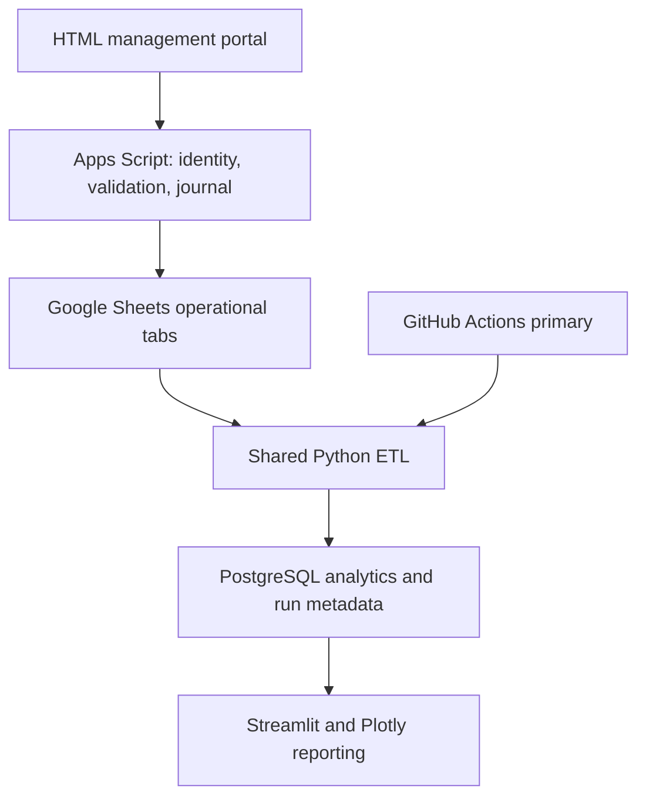

# Architecture and implementation boundary

The repository implements each layer shown above: 19 Apps Script portal pages, backend services, shared Python ETL, the GitHub Actions scheduler, 29 PostgreSQL tables and six Streamlit pages. The dashboard can run locally with synthetic CSV records; external services require the deployment configuration documented in deployment.md.

Operational writes must remain available while reporting is unavailable. Google Sheets is the operational source of truth in the target design; PostgreSQL is the analytical replica. The supplied PostgreSQL schema can also be used to test the business model locally. It is not an assertion that Sheets provides relational constraints.

29 tables include the original masters and transactions, plus brands, segments, roles, price history, audit logs, pipeline runs, quality errors and watermarks. SQL foreign keys represent direct relationships. Receipt and return line relationships pass through their headers and are checked by deferred constraint triggers. The operational services post completed counter sales and their stock movements together under a script lock with redo recovery. Draft reservations and cancellation workflows are not implemented.

The Sheets manifest is the machine-readable tab contract. initializeSuperstore creates tabs with those headers. sample_data/sheets contains empty templates, while the root sample_data CSVs and seed.sql provide the same linked synthetic example. Never share operational sheets directly with ordinary portal users.

Cloud deployment requires the user's Google deployment, PostgreSQL hosting, GitHub secrets. No cloud resources or public URLs are provisioned automatically.

The selected cloud route uses GitHubSync.gs to export a consistent gzip JSON snapshot to a private GitHub repository on an hourly Apps Script trigger. A snapshot push triggers primary_etl.yml to validate and upsert it into Neon using a direct PostgreSQL connection. An hourly Actions schedule retries the latest snapshot. This replaces service-account Sheets extraction for this route; Google Cloud Console and local Docker are unnecessary. See automatic_neon_github.md for setup and freshness limits.

## Operational consistency

Every portal request acquires one script-wide lock. Mutations validate an in-memory snapshot, write a chunked PREPARED redo journal, update the operational tabs, advance a revision marker and clear the journal. Readers replay interrupted prepared changes before serving data. UUID request IDs are persisted as audit IDs to make client retries idempotent. The Sheets API extractor compares the revision and journal markers around its batch read to reject inconsistent snapshots. External spreadsheet edits bypass this protocol and are unsupported.

## Reporting consistency

The ETL reads a complete snapshot for validation, including foreign keys, receipt/return totals and stock-ledger reconciliation. It then writes only newer source versions with PostgreSQL ON CONFLICT, preserving source metadata through a transaction-local trigger setting. Data, watermarks and successful execution status commit together. Invalid snapshots leave analytical records unchanged and create quality errors. One global session advisory lock serializes scheduled, manual and backfill workers. After acquiring it, the next worker can safely mark abandoned runs failed. GitHub Actions retries failed loads and rechecks the latest snapshot hourly.
