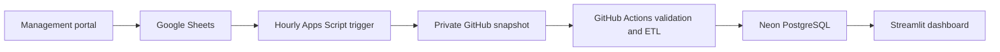

# Fully automatic Sheets → GitHub → Neon

This route needs no Google Cloud Console, service account, Excel downloads or local Docker. The already-authorized Apps Script reads the Sheet, exports one compressed snapshot into a private GitHub repository and GitHub Actions loads it into Neon PostgreSQL. The dashboard reads Neon.



## 1. Create a private GitHub repository

Create a **private** repository, for example `superstore-retail-bi`. Initialize it with a README if creating through the website. Upload this project's code, including hidden .github/workflows files, etl, database, tools, requirements.txt and operational/README.md, to its default branch. The easiest option is VS Code Source Control's Publish to GitHub with **Private** selected, or GitHub Desktop's Add existing repository / Publish repository.

Do not upload .env, downloaded Excel workbooks, Google keys or authentication files. The project's .gitignore excludes those standard paths. Apps Script deliberately rejects a public destination. Exported customer/user/audit records will be retained in the private repository's history, so use only trusted repository collaborators.

## 2. Create Neon and configure the database secret

1. Create a project at https://neon.com and open **Connect**.
2. Turn **connection pooling off** and copy the direct PostgreSQL connection string, preserving its TLS parameters.
3. In GitHub, open the   private repository's **Settings → Secrets and variables → Actions → New repository secret**.
4. Name the secret `DATABASE_URL` and paste the connection string as its value. Do not paste it into source code, workflow YAML or chat.
5. In the repository's **Actions** tab, select **Initialize empty Neon database → Run workflow**. It creates the tables, constraints, indexes and views without sample records.
6. Wait for the green success status before installing the export trigger.

Use an empty Neon database for initialization. The initializer preserves existing databases and refuses partial/unrelated schemas; schema changes later need migrations. It does not erase data or replay seed.sql. The existing ETL uses session advisory locks, which require a direct connection rather than Neon's transaction pooler. Settings rejects the standard Neon pooled hostname to prevent unsafe lock behavior.

## 3. Create a narrowly scoped GitHub token

In GitHub account settings, open **Developer settings → Personal access tokens → Fine-grained tokens → Generate new token**.

- Give it a descriptive name, such as `superstore-sheet-export`.
- Select the repository owner as resource owner.
- Choose **Only select repositories**, selecting only this private repository.
- Under repository permissions, grant **Contents: Read and write**. Metadata read access is included. Workflow write permission is unnecessary.
- Choose an expiry you can maintain, then generate the token. Copy it directly into Apps Script Script Properties. Do not put it in the repository or chat.

An organization may require token approval. Branch protection must permit this token holder to update the operational snapshot path on the default branch. The token's authenticated account performs the commit, so its push can trigger Actions. An expired/revoked token must be replaced in Script Properties.

## 4. Configure Apps Script

GitHubSync.gs and the two additional OAuth scopes must be present in the Apps Script project. `tools/upload_demo_runner.py --file GitHubSync.gs` uploads this file and merges only the required scopes into the remote manifest, preserving the current deployment access settings and other project files.

In **Apps Script → Project Settings → Script Properties**, retain SPREADSHEET_ID and BOOTSTRAP_ADMIN_EMAIL and add:

| Property | Example / value |
| --- | --- |
| GITHUB_OWNER | Your GitHub username or organization, without a URL |
| GITHUB_REPO | Repository name only, e.g. superstore-retail-bi |
| GITHUB_TOKEN | The fine-grained token from step 3 |

There is no branch property: the exporter uses the repository's default branch automatically.

Open GitHubSync.gs, choose **installAutomaticSync**, and click **Run**. Authorize the new external-request and trigger permissions. It verifies the private repository, publishes the first snapshot and creates one hourly time-driven trigger owned by your administrator account. Google may show the unverified-project warning again because the scopes changed.

The source Sheet is read under the same script lock and recovery protocol used by the portal. Ordinary browser entry points require active-user administrator authorization. The scheduled handler is private (its name ends with an underscore) and checks the trigger creator's effective identity against the stored owner and the active administrator records. Portal authentication is not weakened for scheduled execution.

## 5. Verify the automatic route

1. Apps Script's execution log should say `status: installed` and first_export status `exported`.
2. GitHub should contain `operational/snapshot.json.gz` on its default branch.
3. The Actions tab should show **Automatic retail snapshot to Neon**, triggered by that commit, and finish green.
4. In Neon's SQL editor run:

```sql
SELECT COUNT(*) AS orders FROM sales_orders;
SELECT * FROM reporting_daily_sales ORDER BY sales_date DESC;
SELECT status, rows_extracted, rows_loaded, finished_at
FROM pipeline_runs ORDER BY started_at DESC LIMIT 5;
```

The count includes your original records and the 50 additional sales if you ran that loader. Counts are verified in the database rather than assumed by the exporter.

For a quick second check, make an operational change in the portal and run **exportSuperstoreNow** in the editor. It should create a new snapshot commit and workflow run. Subsequent hourly triggers do this automatically. No web-app redeployment is needed for data exports run by editor/trigger functions; the existing portal deployment can continue serving its version.

## 6. Connect Streamlit

Set DATABASE_URL to the Neon connection and DASHBOARD_DEMO=false in your local private .env, or in your dashboard host's secret/environment settings. Start `python -m streamlit run dashboard/app.py` locally if desired; Docker is unnecessary. A hosted dashboard can read Neon while your computer is off, subject to that host's availability and access controls.

Do not replace the local .env with the Neon URL until you have created the project and saved its secret privately. The code does not contain a working Neon connection or GitHub token.

## Timing, failures and maintenance

- Apps Script checks hourly. Time-driven triggers and GitHub runners are best-effort schedules, not an exact-time or instant-sync guarantee.
- Changed data creates one atomic gzip snapshot commit. Unchanged data is skipped, with a fresh heartbeat export after approximately 12 hours.
- Snapshot pushes trigger ETL; an hourly GitHub schedule retries the latest snapshot, including when an earlier run was busy. Manual workflow dispatch is also available.
- Each run rechecks the current period with versioned upserts. It does not duplicate rows, and stale versions cannot overwrite newer records.
- A snapshot older than 26 hours or more than five minutes in the future is rejected. Failed validation leaves reporting data unchanged and records quality errors. If export stops, inspect Apps Script **Executions**, trigger failure emails, token expiry and repository branch rules.
- The exporter caps compressed snapshots at 900 KB; the reader caps decoded JSON at 25 MB. Larger operational datasets require an object-storage export design. This is a portfolio-scale integration, not a high-volume database replication system.
- To stop exports, run **disableAutomaticSync** as an administrator. To transfer ownership or reinstall, have the intended active administrator run installAutomaticSync; review old triggers under their previous owner's account if needed.
- Airflow remains an optional independently hosted recovery layer. GitHub's retry schedule does not provide an independent scheduler host. No Airflow cloud service is provisioned by this setup.

Official references: [GitHub Contents API](https://docs.github.com/en/rest/repos/contents), [GitHub workflow events](https://docs.github.com/en/actions/reference/workflows-and-actions/events-that-trigger-workflows), [Apps Script time triggers](https://developers.google.com/apps-script/guides/triggers/installable), [Apps Script URL Fetch](https://developers.google.com/apps-script/reference/url-fetch), [Neon direct versus pooled connections](https://github.com/neondatabase/website/blob/main/content/docs/get-started/connect-neon.md).
